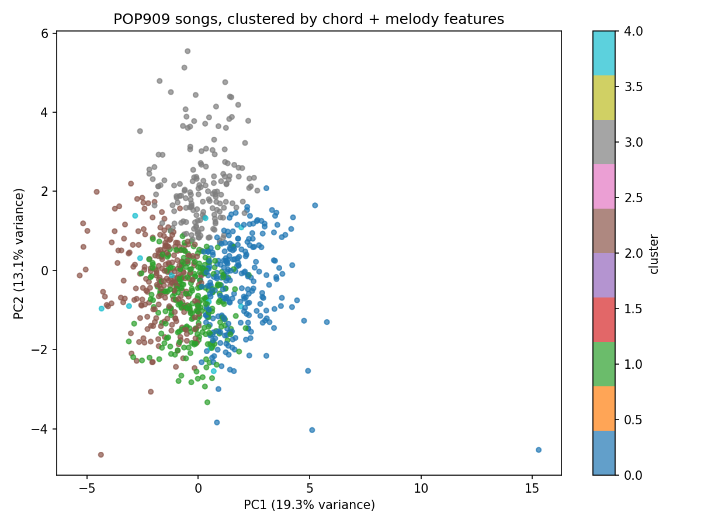

# Beginner Chord Harmonizer

A Transformer model that takes a melody and generates chords for it, with a **hard guarantee** that every chord stays in the song's key *and* can be played by a beginner guitarist using open chord shapes and a capo.

## Why

AI chord generators fall into two camps:

- **Learned models** (e.g. Yeh et al. 2021, Rhyu et al. 2022) produce good-sounding chords from a melody, but nothing stops them from going out of key or suggesting chords that are hard to play.
- **Rule-based systems** (e.g. Sprockeels & Van Roy 2024, Bora 2024) enforce music theory exactly, but don't take a melody as input and don't consider beginners.

This project combines both: a learned melody-to-chord model whose output is filtered by enforced, beginner-focused constraints.

## Key results

- **Capo more than doubles playable chords.** Across all 120,069 chord instances in POP909, the share of chords a beginner can play with open shapes rises from **32.9% with no capo to 73.0%** with the best capo per song.
- **84.7%** of all chords in POP909 are diatonic to a 7-chord scale set, so a scale constraint keeps most real-world coverage.
- **~51% next-chord accuracy** on held-out songs (strict exact-match over a 52-token vocabulary; random guessing is ~1.9%). Since a melody usually has several valid harmonizations, this strict metric understates musical quality.
- **100% constraint satisfaction**: tested on 15 held-out songs across all keys and both modes, every generated chord was in key and playable.



## How it works

1. **Key-relative chord vocabulary** (`vocab.py`): chords are encoded as scale degree + quality (maj/min/dim/aug) relative to the song's tonic, so one model works in all 12 keys. 52 tokens.
2. **Beginner playability from musician input**: feedback from a university Music Society showed that "beginner-friendly" is about *physical chord shape* (open vs. barre), not harmonic complexity. The tool uses the open shapes C, D, Dm, A, Am, G, Em, E.
3. **Capo support**: a capo maps every major key onto C major's easy shapes (and every minor key onto A minor's), resolving the conflict between "stay in key" and "easy to play".
4. **Dataset** (`build_dataset.py`): 909 songs turned into 13,525 overlapping 8-bar windows, split 80/10/10 *by song* to avoid leakage.
5. **Model** (`model.py`, `train.py`): ~1M-parameter Transformer encoder-decoder. The encoder reads melody notes plus mode and capo conditioning tokens; the decoder predicts one chord per half-bar.
6. **Constrained decoding** (`generate.py`): at each step, chords that are out of key or unplayable at the song's capo are masked out entirely. The remaining options are ranked by blending the model's preference with a chord-tone overlap score (how well the chord's notes match the melody).

## Project structure

| File | Purpose |
|---|---|
| `vocab.py` | Chord vocabulary, scale sets, capo logic, chord-tone overlap |
| `build_dataset.py` | Builds the training windows from POP909 |
| `dataset.py`, `model.py` | Dataset loader and Transformer model |
| `train.py` | Training loop with early stopping |
| `generate.py` | Constrained chord generation |
| `best_model.pt` | Trained model checkpoint |
| `extract_features.py`, `similarity_analysis.py` | Exploratory analysis (song features, PCA, clustering) |
| `check_*.py`, `test_*.py` | Validation scripts |

## Setup

```bash
git clone https://github.com/lamiazahid/beginner-chord-harmonizer.git
cd beginner-chord-harmonizer
pip install -r requirements.txt

# Get the dataset (not included in this repo)
git clone https://github.com/music-x-lab/POP909-Dataset.git

python build_dataset.py   # creates dataset.json
python generate.py        # generate chords with the trained model
python train.py           # (optional) retrain from scratch
```

## Limitations and future work

- On very sparse melodies, greedy decoding can repeat one chord; sampling or beam search would fix this.
- The IV chord and diminished chords have no open shape, so they're unavailable in some keys.
- Next steps: compare against baselines and run a user study with beginner guitarists.

## Acknowledgements

Dataset: [POP909](https://github.com/music-x-lab/POP909-Dataset) (Wang et al., 2020).
